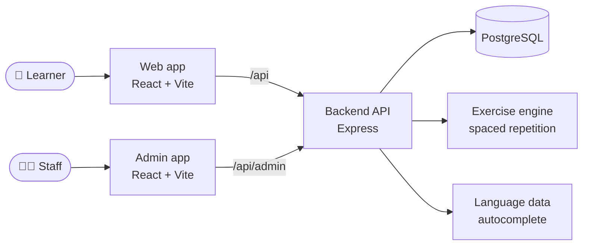
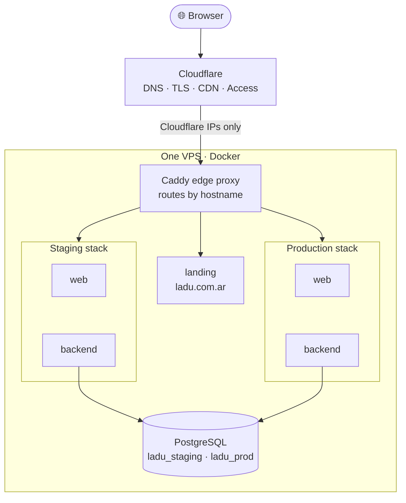
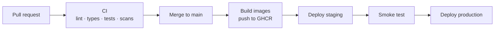

<p align="center">
  
</p>

<h3 align="center">Keep every language you speak alive.</h3>

<p align="center">
  A multilingual vocabulary manager for polyglots, with an adaptive practice engine.
</p>

<p align="center">
  
  
  
  
  
  
</p>

<p align="center">
  <a href="#-what-is-ladu">What is Ladu</a> ·
  <a href="#-features">Features</a> ·
  <a href="#-architecture">Architecture</a> ·
  <a href="#-infrastructure">Infrastructure</a> ·
  <a href="#-getting-started">Getting started</a> ·
  <a href="#-roadmap">Roadmap</a>
</p>

---

## 🌍 What is Ladu?

You learned Spanish. Then German. Then Estonian. Now your Spanish is rusty.

Most vocabulary apps teach **one new language** and pair it with **your native language**.
Your older languages get no practice, so they fade.

**Ladu** fixes this. It is a digital notebook and practice suite for people who speak **several languages** and want to keep **all** of them.

- A **Word** is one *concept*, for example "to dance".
- That Word holds its **translations in many languages at the same time**: *dance* (EN), *bailar* (ES), *tanzen* (DE), *tantsima* (EE).
- Each translation stores full **grammar**: conjugations, declensions, gender, and more.
- Ladu uses this data to build **practice between any two of your languages**, not only "native ↔ target".

```text
              ┌──────────────────────────────┐
              │   Word  ·  "to dance"  ·  Verb │
              └──────────────┬───────────────┘
        ┌───────────┬────────┴───┬────────────┐
        ▼           ▼            ▼            ▼
      🇬🇧 EN        🇪🇸 ES        🇩🇪 DE        🇪🇪 EE
      dance        bailar       tanzen       tantsima
      + forms      + forms      + forms      + forms
```

> **Supported languages:** English, Spanish, German, Estonian.
> A Word needs translations in at least **two** languages.

> [!NOTE]
> This repository is the **v2 rebuild** of Ladu. The backend came from the first version. The frontend is a new build on a modern stack.

## ✨ Features

| | Feature | What it does |
|---|---|---|
| 📚 | **Word dictionary** | Add, edit, search and filter words. A table shows one column for each language you use. |
| 🧠 | **Grammar-aware forms** | The form changes with the part of speech (noun, verb, adjective, adverb) and the language. |
| ⚡ | **Autocomplete** | Type a base form. Ladu suggests conjugations, declensions and gender from language data, so you type less. |
| 🏷️ | **Tags** | Group words into lists. Tags can be Private or Public. Public tags can be followed or cloned. |
| 🎯 | **Adaptive practice** | Spaced repetition (forgetting curve) picks what to practise next. Text-input and multiple-choice cards. |
| ✅ | **Mastery control** | Mark a translation as *Mastered* or *Revise*. See your recent results at all times. |
| 📊 | **Dashboard** | Charts for vocabulary by language and part of speech, growth over time, and mastery. |
| 🌗 | **Dark mode & UI languages** | The interface works in EN, ES, DE and EE, in light and dark themes. |
| 🛡️ | **Verified badges** | The owner can mark official accounts. Tags from these accounts show a seal. |
| 🧑‍💼 | **Admin dashboard** | A separate staff tool for access requests, badges and the audit log. |

### Design principles

1. Word entry must be **fast** and without friction.
2. Social features are **always optional**. Words and exercises work fully when you are alone.
3. The core dictionary is **never hard to reach**.
4. All languages are **shown equally**. No language is the "main" one.
5. Grammar detail is **captured without overloading** the screen.
6. **Every stored datum** feeds practice and statistics.
7. Your **progress is always clear**.

## 🏗️ Architecture

Ladu is an **npm-workspaces monorepo**.

| Workspace | What it is | Main tech |
|---|---|---|
| [`backend/`](backend) | REST API, auth, exercise engine | Node 24, Express, Drizzle ORM, PostgreSQL, Jest |
| [`frontend/`](frontend) | The learner web app | React 18, Vite, TypeScript, Tailwind CSS 4, TanStack Query, Zustand, react-hook-form, i18next, Vitest, MSW |
| [`admin/`](admin) | Staff dashboard (separate app) | React, Vite, Vitest |
| [`landing/`](landing) | Public site and blog | Static HTML/CSS/JS, Markdown posts |
| [`e2e/`](e2e) | Full-stack browser tests | Playwright |
| [`deploy/`](deploy) | Servers and releases as code | Terraform, Ansible, Docker Compose, Caddy |
| [`word-lists/`](word-lists) | Starter vocabulary | Data files |



Every phase of the build ends with a **green Playwright run**. These tests start the real backend, a real PostgreSQL database and a real browser.

## 🚀 Infrastructure

One small VPS runs everything. Cloudflare is in front of it.



| Layer | Tool | Job |
|---|---|---|
| **Edge** | Cloudflare | DNS, TLS, CDN. Only Cloudflare IPs can reach the server. Cloudflare Access protects the admin site. |
| **Provisioning** | Terraform | Cloudflare DNS records and Access rules, as code. |
| **Server setup** | Ansible (with Vault) | Server packages, firewall, fail2ban, Postgres, Caddy. Can be re-run safely. |
| **Routing** | Caddy | One IP address, split by hostname: `app.`, `staging.`, `admin.`, `admin-staging.` and the apex domain. |
| **Runtime** | Docker Compose | One *platform* stack (Postgres, Caddy, landing). One *app* stack for each environment. |
| **CI/CD** | GitHub Actions + GHCR | Lint, typecheck, tests and image scans on each pull request. Each merge to `main` builds one image set. |
| **Monitoring** | Sentry, UptimeRobot | Error tracking and uptime alerts. |
| **Backups** | `pg_dump` to Backblaze | Database backups off the server. |
| **Abuse control** | Cloudflare Turnstile | Captcha on sign-up forms (built, not yet switched on). |

**Build once, deploy many.** Each commit builds one image. The same image goes to **staging**, then a smoke test runs, then it goes to **production**. Staging never runs different code from production.



Full operator manual: [`.dev-context/infrastructure-guide/`](.dev-context/infrastructure-guide/README.md)

## 🛠️ Getting started

**You need:** Node 24 (see `.nvmrc`) and Docker.

```bash
# 1. Install dependencies for all workspaces
npm install

# 2. Start the local PostgreSQL database
npm run docker:up

# 3. Create the database tables
npm run db:migrate

# 4. Start the backend (:5001) and the frontend (Vite)
npm run dev
```

The backend needs a `backend/.env` file. Use the existing variables in the repo as a guide.

### Useful commands

| Command | What it does |
|---|---|
| `npm run dev` | Backend and frontend together |
| `npm run dev:admin` | Backend and admin app together |
| `npm test` | Backend tests (Jest) |
| `npm test -w frontend` | Frontend tests (Vitest) |
| `npm run e2e:install` | One-time: download the browser for Playwright |
| `npm run test:e2e` | Full-stack end-to-end tests |
| `npm run db:studio` | Open Drizzle Studio to look at the data |
| `npm run build` | Production build of the frontend |

## 🗺️ Roadmap

### Done

- [x] Accounts: sign-up, email check, sign-in, password reset
- [x] Dictionary: words, translations and grammar forms
- [x] Autocomplete from language data
- [x] Tags, with follow and clone for Public tags
- [x] Practice engine with spaced repetition and saved sessions
- [x] Dashboard and statistics
- [x] Dark mode and four interface languages
- [x] Admin dashboard, access gates and verified badges
- [x] Staging and production pipeline, monitoring and backups
- [x] Demo mode and first-login onboarding

### Still to do: the social layer

The social features are **optional by design**, so they come after the solo loop. The database schema for them is ready. The code and tests are still to do.

- [ ] 🤝 **Friends**: search users, send, accept and reject requests, block users
- [ ] 🔔 **Notifications**: friend requests and tag-share invites, with unread counters and a panel
- [ ] 🏷️ **Friends-only tags**: tags that only confirmed friends can see and copy
- [ ] 📨 **Tag sharing**: invite a friend to a tag

### Other open items

- [ ] Review of the ES, DE and EE interface text for onboarding, demo and captcha
- [ ] More sources for German and Estonian word data.

Detailed plans are in [`.context/plans/`](.context/plans). The product specification is in [`.context/overview.md`](.context/overview.md).

## 📖 Documentation

| Document | Content |
|---|---|
| [`.context/overview.md`](.context/overview.md) | Product and domain specification |
| [`.context/README.md`](.context/README.md) | Commands, conventions and spec index |
| [`.context/plans/`](.context/plans) | Plan for each phase and feature |
| [`.dev-context/infrastructure-guide/`](.dev-context/infrastructure-guide/README.md) | Operator manual: servers, environments, secrets, troubleshooting |
| [`e2e/README.md`](e2e/README.md) | How to run the end-to-end tests |
| [`landing/README.md`](landing/README.md) | How to write a blog post |

## 📄 License

[MIT](LICENSE) © 2026 Kevin Raud
